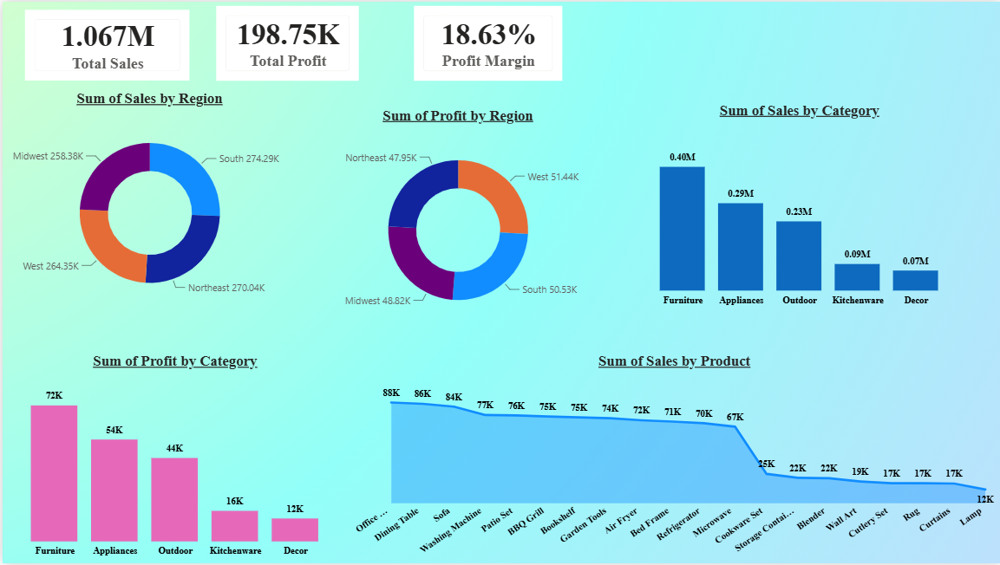

# BrightHome Retail — Sales Analytics Dashboard

A Power BI portfolio project exploring a simulated home-goods retailer's orders, recorded sales, profit, discounting, regional performance, and shipping costs.



## Project summary

| Measure | Verified result |
|---|---:|
| Source records | 2,500 |
| Distinct orders | 2,500 |
| Unique customers | 855 |
| Date range | 2023-01-01 to 2025-12-31 |
| Recorded Sales | $1,067,061.93 |
| Profit (source column) | $198,747.08 |
| Shipping costs | $76,477.65 |
| Profit less shipping costs | $122,269.43 |

**Metric-definition caveat:** The source workbook has a separate `Discount` percentage column, but `Sales = Quantity × UnitPrice` in all 2,500 records. Recorded `Sales` does not deduct discounts. Describe it as *recorded Sales on a pre-discount basis* until the intended revenue policy is confirmed.

The project description uses dollar formatting and describes a fictional US retailer, but the workbook does not store a currency code. Confirm currency before using the file outside the portfolio scenario.

## Headline metrics

| Measure | Result | Definition |
|---|---:|---|
| Recorded Sales | $1,067,061.93 | Sum of `Sales` |
| Total Profit | $198,747.08 | Sum of source `Profit` |
| Profit / recorded Sales | 18.63% | `SUM(Profit) / SUM(Sales)` |
| Shipping costs | $76,477.65 | Sum of `ShippingCost` |
| Profit less shipping costs | $122,269.43 | Assumes Profit excludes shipping |
| Profit less shipping / recorded Sales | 11.46% | Post-shipping profit / recorded Sales |
| Average order value | $426.82 | Recorded Sales / distinct orders |
| Average profit per order | $79.50 | Profit / distinct orders |
| Mean order discount | 6.54% | Unweighted average of `Discount` |
| Orders with a non-zero discount | 1,497 (59.88%) | Count where `Discount > 0` |
| Average shipping cost | $30.59 | Shipping cost per order |
| Recorded Sales / shipping cost | 13.95x | Total Sales / total shipping cost |

A separate exploratory calculation estimates discounts at **$73,494.18** and discount-adjusted Sales at **$993,567.75** from `Sales × Discount`. These are proxies, not confirmed accounting measures: the workbook has no explicit `DiscountAmount` or `NetSales` field and no documented per-order rounding rule. Do not change the margin denominator without checking how the Profit measure treats discounts.

## Verified findings

- **South leads in recorded Sales:** $274,292.29. **West leads in total Profit:** $51,438.77 and has the highest regional Profit/Sales ratio (19.46%).
- **Furniture leads category Sales and total Profit:** $403,893.16 in Sales and $72,102.74 in Profit. Its Profit/Sales ratio is 17.85%; Outdoor has the highest category ratio at 19.58%.
- **Office Chair leads product Sales:** $87,643.02. Sofa has the highest product Profit at $15,826.54.
- **Shipping warrants follow-up:** assuming Profit excludes shipping, Decor Profit ($12,168.80) is below ShippingCost ($15,231.63), a difference of -$3,062.83. Kitchenware has only $1,335.25 left after shipping.
- **Annual Sales:** $356,708.02 in 2023, $349,858.76 in 2024 (-1.92%), and $360,495.15 in 2025 (+3.04%).
- **Discount-profit Pearson correlation:** -0.032, a very weak linear relationship that does not establish causation.
- **All 50 documented business-question answers reconcile numerically to the workbook.** The audit identifies definition/label caveats rather than headline arithmetic discrepancies.

## Audit and supporting files

- [Full data audit and reconciliation notes](docs/data-audit-and-reconciliation.md)
- [Reconciliation of all 50 business questions](reports/metric-reconciliation.csv)
- [Data-quality audit JSON](reports/data-quality-audit.json)
- [Data dictionary](docs/data-dictionary.md)
- [Updated business questions and answers](docs/50-business-questions-answers.md)

## Reproduce the audit

From the repository root, run with Python 3.10+:

```bash
python scripts/audit_brighthome.py
```

The standard-library script reads the XLSX package, checks data shape and the Sales calculation, and regenerates the quality-audit JSON. It does not modify the workbook or PBIX.

## Recommendations

1. Define Sales/discount policy. If net Sales are needed, document a DiscountAmount and NetSales formula plus a per-order rounding rule.
2. Confirm what Profit includes before treating `Profit - ShippingCost` as a contribution measure.
3. Label 18.63% as Profit / recorded Sales and 11.46% as (Profit − ShippingCost) / recorded Sales until the margin basis is verified.
4. Review categories/products where shipping may absorb much of the recorded Profit.
5. Measure discount policy changes with a baseline and controlled test rather than inferring causality from a near-zero correlation.

## Tools demonstrated

Power BI, Power Query, DAX, Excel, data-quality validation, metric reconciliation, descriptive statistics, and business communication.
